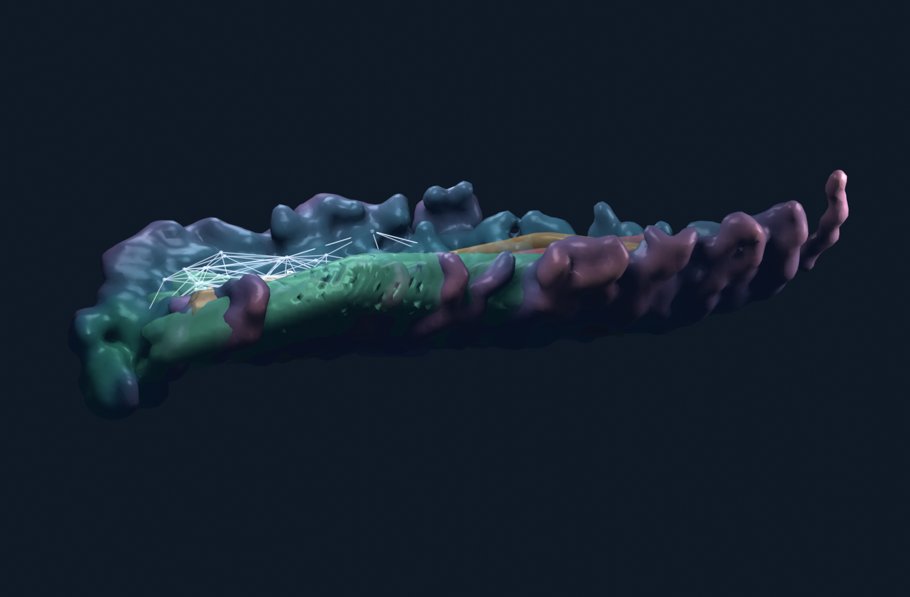

# Molecular Atlas: trajectories, geometry and categorical nerves

**Joseph Campagna, PSM**

An exploratory visualization of molecular dynamics: conformations form a landscape,
translucent pathway skins deform with recorded geometry, and simplicial nerves make
overlap and path composition visible. Includes **alanine dipeptide** and the
ten-residue chignolin variant **CLN025**.

> This is a scientific visualization prototype, not a validated kinetic model.
> The paper explains the mathematical construction, limitations, and future directions.

**[Read the illustrated paper (PDF)](paper/molecular-atlas.pdf)** ·
**[Open the public viewer](https://joecampdb.github.io/pronerv_MTNerv/)** ·
[Reproduce the analysis](alanine-nerve/README.md) · [Data attribution](DATA_SOURCES.md)

**[LinkedIn carousel (10-slide PDF)](paper/molecular-atlas-linkedin-carousel.pdf)** ·
[Alanine annotated nerve](alanine-nerve/paper/figures/alanine-nerve-annotated-both.png) ·
[CLN025 annotated nerve](alanine-nerve/paper/figures/chignolin-nerve-annotated-both.png)

[Download all annotated viewpoints (PNG + SVG)](paper/annotated-nerve-views.zip).
The monochrome nerve plates show oblique and overhead views with vertex markers,
inclusion-edge legends, and a labeled example simplex. They show the complete
exported overlap 2-skeleton; kinetic transitions belong to the separate path nerve.



## Run in one command

Python 3 is enough to view the checked-in assets. No Node packages, MD downloads,
Blender installation or build step are needed.

```bash
git clone https://github.com/joecampdb/pronerv_MTNerv.git
cd pronerv_MTNerv
python -m http.server 8765 --directory alanine-nerve/dist
```

Open **http://localhost:8765/** and switch between Alanine and Chignolin in the
header. Use an HTTP server; opening HTML directly from the filesystem will not work.

1. Turn on the overlap nerve and select a witnessed overlap object.
2. Choose a transition route to isolate its molecular skin.
3. Scrub the visual phase or adjust deformation amplitude to see actual mesh motion.
4. Select a composable pair to inspect a dynamic nerve 2-simplex.
5. Inspect the backbone cartoon; export the landscape as a PNG.

The Sites-hosted instance is separately access-controlled. The public GitHub Pages
viewer and a local server use the same static assets.

## Two examples, one construction

| | Alanine dipeptide | Chignolin CLN025 |
|---|---|---|
| Molecular representation | 10 heavy atoms | 10 Cα backbone sites |
| Chart | Backbone φ, ψ | Cα radius of gyration, end-to-end distance |
| Recorded frames | 750,000 | 63,999 |
| Independent runs | 3 | 128 selected from 3,744 |
| Temperature | 300 K | 350 K |
| Observed route types | 10 | 12 |
| Overlap nerve objects / arrows / 2-simplices | 91 / 282 / 204 | 97 / 342 / 264 |
| Composable generator pairs | 25 | 36 |

CLN025 is **YYDPETGTWY**, not original chignolin. Its trajectories were adaptively
sampled. The chart displays negative log pooled occupancy, **not equilibrium free
energy**. A timestamp discrepancy is preserved in provenance and discussed in the
paper; chignolin passage analysis uses frame indices.

The overlap category is a face poset of a witnessed simplicial complex. The
dynamic category is the free category on observed route types. A composite
`A → B → C` is distinct from an independently observed `A → C` generator.
Neither construction by itself proves a molecular configuration-space nerve theorem
or a compositional model of full dynamical systems.

## Repository guide

| Location | Contents |
|---|---|
| [`paper/molecular-atlas.pdf`](paper/molecular-atlas.pdf) | Compiled, illustrated exploratory paper |
| [`alanine-nerve/dist/`](alanine-nerve/dist/) | Ready-to-run viewer, derived geometry and provenance |
| [`alanine-nerve/paper/`](alanine-nerve/paper/) | LaTeX, Blender scripts/scenes, figures, videos, LinkedIn draft |
| [`alanine-nerve/README.md`](alanine-nerve/README.md) | Environment setup and complete reproduction commands |
| [`docs/alanine-methods.md`](docs/alanine-methods.md) | Detailed alanine construction and development history |
| [`DATA_SOURCES.md`](DATA_SOURCES.md) | Data identity, selection, attribution and licensing |
| [`CONTRIBUTING.md`](CONTRIBUTING.md) | Development and validation expectations |

The historical `alanine-nerve` directory name is retained for compatibility.

## Independent polyethylene workflow

This repository also preserves an earlier PE25/PE50 simulation-screening project.
It is **separate from the molecular atlas** and is not required for the viewer or
paper. Its original setup and scientific protocol are retained in
[`docs/polyethylene-workflow.md`](docs/polyethylene-workflow.md).
Existing scripts and simulation directories keep their original locations.

## Validation and scope

Offline automated tests check the static asset contract, nerve inclusions and composition, route
provenance bounds, finite changing morph targets, fixed attached endpoints, and
JavaScript syntax. Optional raw-data validation independently reconstructs
chignolin passage counts and verifies rigid-coordinate invariants.
These checks establish implementation consistency, not physical validity.
Optional GitHub Actions templates are in `docs/github-workflows/`; they are not
active workflows. The publication credential lacked the required workflow scope.
The public viewer is served from the `gh-pages` branch.

See the paper's **Limitations and obstacles encountered** and **Future directions**
sections before reusing scientific interpretations. Contributions that add
uncertainty estimates, kinetic validation, richer conformational features, or
explicit compositional interfaces are welcome.
