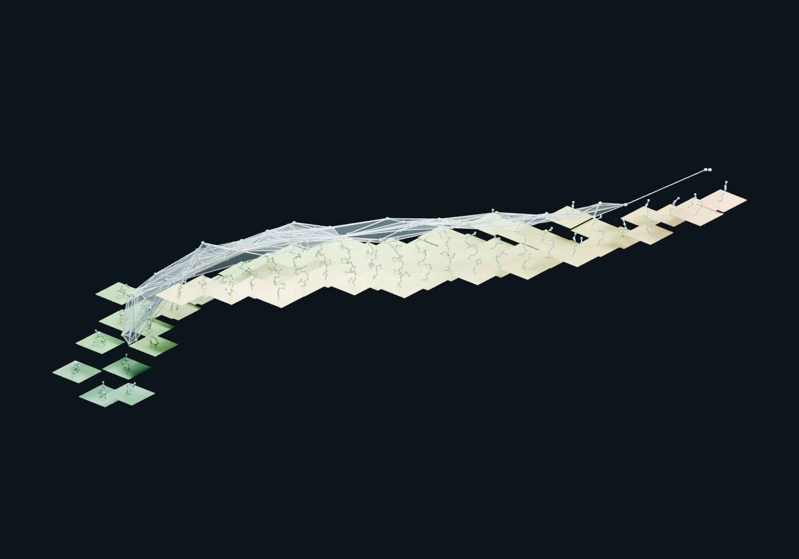

# Molecular Atlas: trajectories, geometry and categorical nerves

**Joseph Campagna, PSM**

An exploratory molecular atlas with measured structural-mobility heights,
recorded conformations, and categorical overlap nerves. Includes **alanine
dipeptide** and the ten-residue chignolin variant **CLN025**. The earlier
continuous molecular-skin artwork remains a labeled illustrative baseline.

**Measured revision:** [Evidence and reproduction](alanine-nerve/VALIDATION.md) ·
[Revised limitations source](alanine-nerve/paper/limitations.tex) ·
[Revised Figure 9](alanine-nerve/paper/figures/measured-height-revision.png).
This revision is local and has not automatically replaced the public viewer,
previously published PDF, or social-media artifacts.

> This is a scientific visualization prototype, not a validated kinetic model.
> The paper explains the mathematical construction, limitations, and future directions.

**[Previously published paper (PDF)](paper/molecular-atlas.pdf)** ·
**[Public illustrative viewer](https://joecampdb.github.io/pronerv_MTNerv/)** ·
[Reproduce the analysis](alanine-nerve/README.md) · [Data attribution](DATA_SOURCES.md)

**[LinkedIn carousel (10-slide PDF)](paper/molecular-atlas-linkedin-carousel.pdf)** ·
[Alanine annotated nerve](alanine-nerve/paper/figures/alanine-nerve-annotated-both.png) ·
[CLN025 annotated nerve](alanine-nerve/paper/figures/chignolin-nerve-annotated-both.png)

[Download all annotated viewpoints (PNG + SVG)](paper/annotated-nerve-views.zip).
These earlier monochrome plates show oblique and overhead views with vertex markers,
inclusion-edge legends, and a labeled example simplex. They show the complete
exported overlap 2-skeleton; kinetic transitions belong to the separate path nerve.



## Run in one command

Python 3 is enough to view the checked-in assets. No Node packages, MD downloads,
Blender installation or build step are needed.

```bash
git clone https://github.com/joecampdb/pronerv_MTNerv.git
cd pronerv_MTNerv
python -m http.server 8765 --directory alanine-nerve/dist
```

Open **http://localhost:8765/measured.html** and switch between Alanine and CLN025.
Use an HTTP server; opening HTML directly from the filesystem will not work.

1. Inspect supported mobility tiles; absent tiles have insufficient support.
2. Toggle the overlap nerve, triangular plates and conditional spread bars.
3. Compare mobility, resampling spread and raw-data dominance colors.
4. Step through actual recorded frames without synthetic interpolation.
5. Use the alanine torus view to inspect periodic identifications.

The Sites-hosted instance is separately access-controlled. Public GitHub Pages
still serves the earlier release; local measured assets are a newer revision.

## Two examples, one construction

| | Alanine dipeptide | Chignolin CLN025 |
|---|---|---|
| Molecular representation | 10 heavy atoms | 10 Cα backbone sites |
| Chart | Backbone φ, ψ | Cα radius of gyration, end-to-end distance |
| Recorded frames | 750,000 | 1,868,861 |
| Trajectory files | 3 | 3,744 adaptive trajectories |
| Temperature | 300 K | 350 K |
| Mobility lag | 100 ps | 10 frames; physical clock unresolved |
| Height averaging | Pair-weighted | Equal root-conditional means |
| Supported height bins | 100 | 78 |
| Display-category objects / inclusions / triangles | 78 / 212 / 138 | 131 / 466 / 360 |
| Full witnessed complex maximum dimension | 3 | 5 |

CLN025 is **YYDPETGTWY**, not original chignolin. Its trajectories were adaptively
sampled. The revised chart displays descriptive structural mobility in nm,
**not equilibrium free energy**. Root balancing is not an equilibrium correction.
Intervals are conditional spread, not calibrated confidence intervals. A timestamp
discrepancy is preserved; CLN025 analyses use frame indices. Legacy passage
demonstrations retain 10 alanine and 12 CLN025 route types, with 25 and 36 formal
generator pairs; these do not validate composition of molecular dynamics.

The overlap category is a face poset of a witnessed simplicial complex. The
dynamic category is the free category on observed route types. A composite
`A → B → C` is distinct from an independently observed `A → C` generator.
Neither construction by itself proves a molecular configuration-space nerve theorem
or a compositional model of full dynamical systems.

## Repository guide

| Location | Contents |
|---|---|
| [`paper/molecular-atlas.pdf`](paper/molecular-atlas.pdf) | Compiled, illustrated exploratory paper |
| [`alanine-nerve/dist/`](alanine-nerve/dist/) | Ready-to-run viewer, derived geometry and provenance |
| [`alanine-nerve/paper/`](alanine-nerve/paper/) | LaTeX, Blender scripts/scenes, figures, videos, LinkedIn draft |
| [`alanine-nerve/README.md`](alanine-nerve/README.md) | Environment setup and complete reproduction commands |
| [`docs/alanine-methods.md`](docs/alanine-methods.md) | Detailed alanine construction and development history |
| [`DATA_SOURCES.md`](DATA_SOURCES.md) | Data identity, selection, attribution and licensing |
| [`CONTRIBUTING.md`](CONTRIBUTING.md) | Development and validation expectations |

The historical `alanine-nerve` directory name is retained for compatibility.

## Fluid nerve atlas (many systems)

[`fluid-nerve/`](fluid-nerve/README.md) extends the two-system construction to a catalog of systems,
half atom-based (heavy-atom sites: alanine dipeptide, a locally generated family of twenty capped
dipeptides, MD17/MD22 ab initio trajectories) and half backbone-based (C-alpha sites: CLN025 and mdCATH
domains). For every system it builds a **deformation field** (lag-ladder conditional mobility, drift,
spread and site displacement), the **witnessed cover nerve** of the measured revision, an **ambient-time
(fluid) filtration** of nerves and the **flooding filtration** of the occupancy landscape; it exports every
nerve to [homotopy.io](https://homotopy.io) as a 3-dimensional categorical complex
([instructions](fluid-nerve/docs/homotopy-io-instructions.md)); and it compares the two groups,
including an empirical atomistic-to-C-alpha comparison functor. The accompanying paper,
*Fluid nerve theory* (`fluid-nerve/dist/fluid-nerve-theory.pdf`), recruits synthetic differential geometry
to state what a deformation field is at an infinitesimal scale and proves that nerves of formally open
covers are rigid under infinitesimal transformations. An atlas PDF (`fluid-nerve/dist/fluid-nerve-atlas.pdf`) gives a legend in categorical terms, a catalog
of all systems and one plate per system; a short video (`fluid-nerve/dist/video/`) shows the nerve plate
rising out of alanine dipeptide. The alanine build reproduces the measured atlas of this repository
exactly. All constructions remain descriptive.

## Independent polyethylene workflow

This repository also preserves an earlier PE25/PE50 simulation-screening project.
It is **separate from the molecular atlas** and is not required for the viewer or
paper. Its original setup and scientific protocol are retained in
[`docs/polyethylene-workflow.md`](docs/polyethylene-workflow.md).
Existing scripts and simulation directories keep their original locations.

## Validation and scope

Offline automated tests check the static asset contract, nerve inclusions and composition, route
provenance bounds, finite changing morph targets, fixed attached endpoints, and
JavaScript syntax. Optional raw-data validation independently reconstructs
chignolin passage counts and verifies rigid-coordinate invariants.
These checks establish implementation consistency, not physical validity.
Optional GitHub Actions templates are in `docs/github-workflows/`; they are not
active workflows. The publication credential lacked the required workflow scope.
The public viewer is served from the `gh-pages` branch.

See the paper's **Limitations and obstacles encountered** and **Future directions**
sections before reusing scientific interpretations. Contributions that add
uncertainty estimates, kinetic validation, richer conformational features, or
explicit compositional interfaces are welcome.
